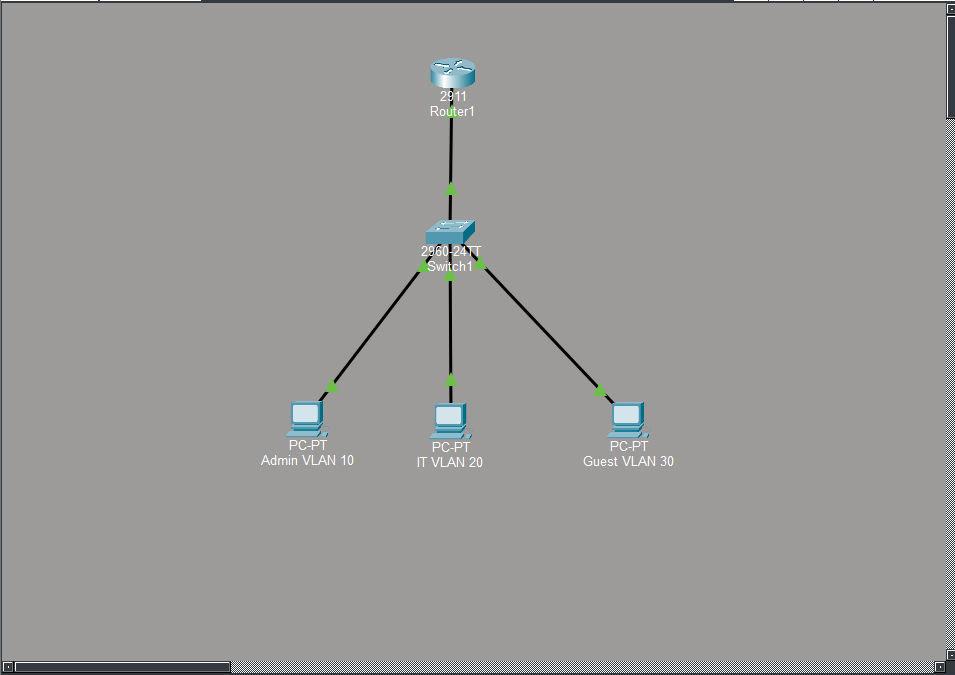
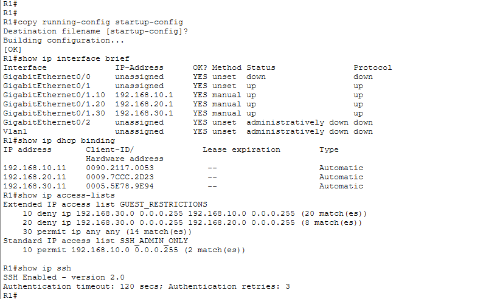
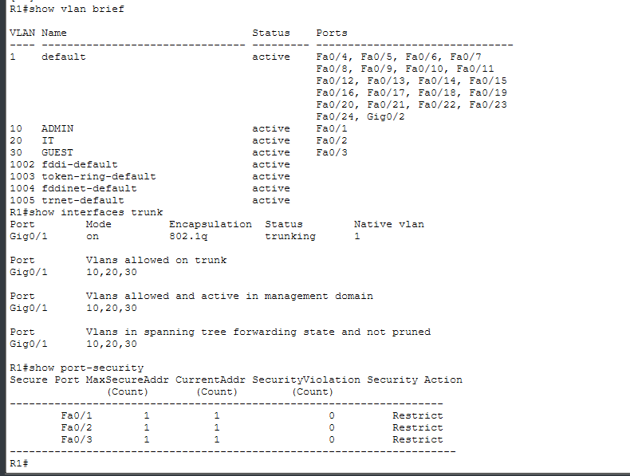

# Cisco Enterprise Network Security Lab

## Project Overview

This project demonstrates the configuration and security of a small enterprise network using Cisco Packet Tracer. The lab focuses on VLAN segmentation, inter-VLAN routing, DHCP, access control lists (ACLs), SSH remote management, and switch port security.

## Network Topology

### Network Configuration

| VLAN | Department | Network | Default Gateway |
|---|---|---|---|
| 10 | ADMIN | 192.168.10.0/24 | 192.168.10.1 |
| 20 | IT | 192.168.20.0/24 | 192.168.20.1 |
| 30 | GUEST | 192.168.30.0/24 | 192.168.30.1 |

## Technologies Used

- Cisco Packet Tracer
- Cisco 2911 Router
- Cisco 2960 Switch
- IEEE 802.1Q VLAN Trunking
- Router-on-a-Stick
- DHCP
- Extended and Standard ACLs
- SSH Version 2
- Sticky MAC Address Port Security

## Implementation

### VLAN Segmentation and Routing

Configured three VLANs for Admin, IT, and Guest departments. Implemented router-on-a-stick using 802.1Q subinterfaces to enable inter-VLAN routing.

### DHCP Configuration

Configured three DHCP pools on the router to automatically assign IP addresses and default gateways to devices in each VLAN.

### Guest Network Isolation

Implemented an extended ACL to prevent Guest VLAN devices from accessing the Admin and IT networks while maintaining connectivity to their local gateway.

### Secure Remote Management

Configured SSH version 2 with local authentication and restricted router management access to the Admin VLAN using a standard ACL.

### Switch Port Security

Enabled sticky MAC address learning on three switch access ports, limiting each port to one secure MAC address and using restrict mode for violations.

## Testing and Verification

The following tests were completed:

- Verified inter-VLAN connectivity before applying security restrictions.
- Confirmed successful DHCP address assignment across all three VLANs.
- Verified Guest VLAN traffic was blocked from Admin and IT.
- Confirmed Admin SSH access was successful while IT and Guest access was blocked.
- Verified three sticky MAC addresses were learned with zero recorded port-security violations.

### Router Verification

### Switch Verification

## Key Learning Outcomes

This lab provided hands-on experience with enterprise network configuration, troubleshooting, segmentation, access control, secure device management, and Layer 2 port security.

## Project Status

Technical configuration and verification completed.

**Environment:** Cisco Packet Tracer — simulated network for educational and portfolio purposes.
